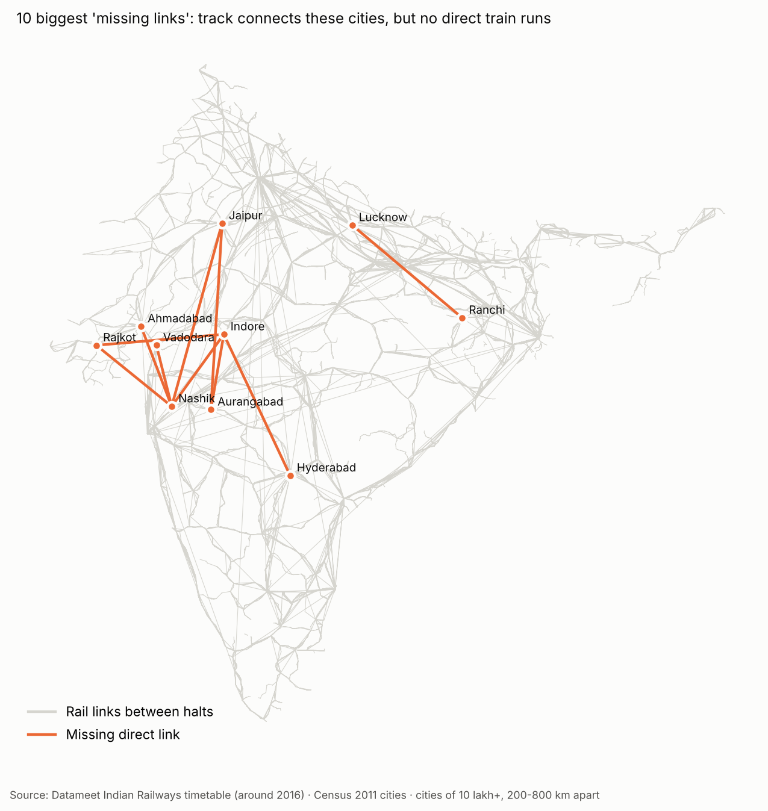
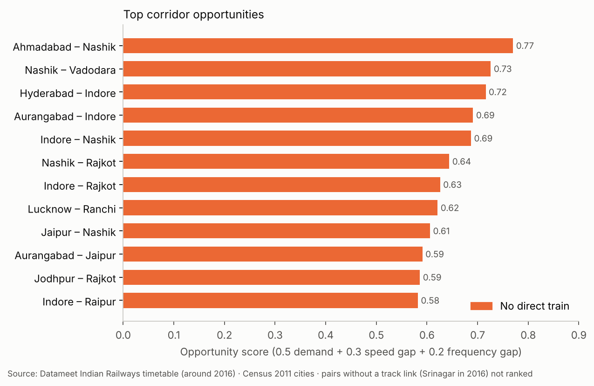
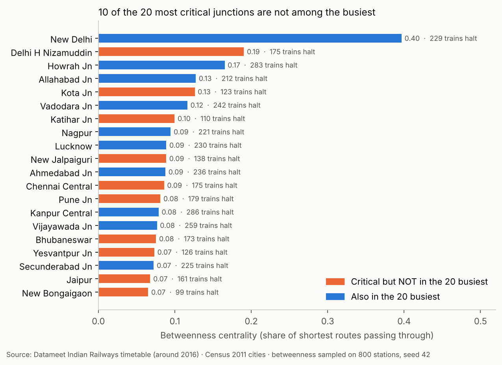
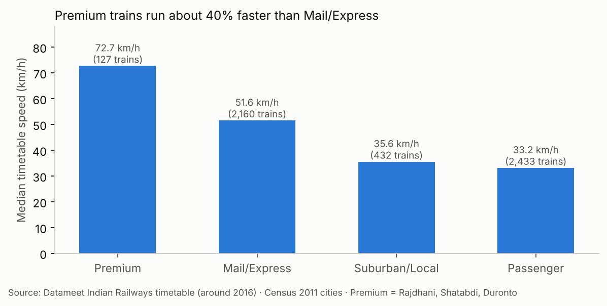
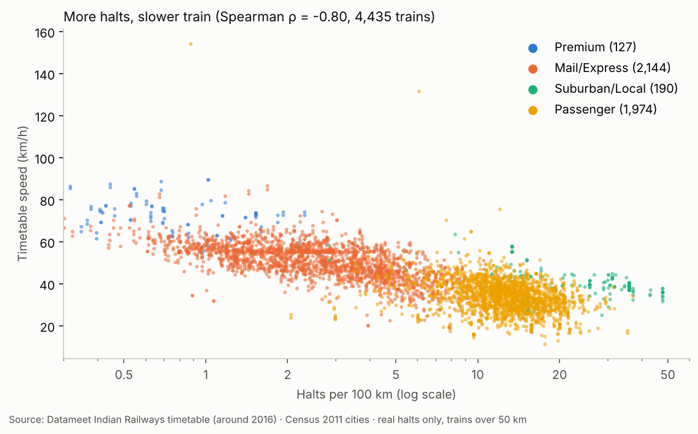
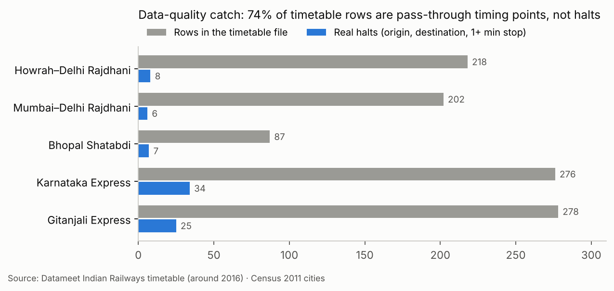

# Missing Links — Indian Railways Network Speed & Service Gap Study

**Where does India most need faster direct trains?** An end-to-end analysis of the Indian Railways timetable using Python, SQL, Excel, Power BI and Tableau.



## Key findings (timetable snapshot, around 2016)
| # | Finding |
|---|---------|
| 1 | Premium trains (Rajdhani, Shatabdi, Duronto) run at a median **72.7 km/h** vs **51.6 km/h** for Mail/Express and 33.2 km/h for Passenger trains |
| 2 | Trains with more halts per 100 km are markedly slower (Spearman correlation **−0.80**, 4,435 trains) |
| 3 | **10 of the 20 most critical junctions** (betweenness) are not among the 20 busiest stations, e.g. Kota, Katihar, New Jalpaiguri |
| 4 | Of 272 pairs of 10 lakh+ cities 200–800 km apart, **24 have no direct train even though the track connects them**; top opportunities: Ahmadabad–Nashik, Nashik–Vadodara, Hyderabad–Indore |

| Top corridor opportunities | Busiest vs most critical junctions |
| --- | --- |
|  |  |

| Speed by train category | Halts vs speed |
| --- | --- |
|  |  |

**Data-quality catch:** 74% of the timetable rows are stations a train only passes, not halts. Counting them as halts made small wayside stations look like top hubs, so the analysis separates real halts first.



## Data
- [Datameet Indian Railways](https://github.com/datameet/railways): stations, trains and schedules (collected around 2016 by Sanjay Bhangar and Sajjad Anwar)
- Census 2011 city populations
- Raw data is not committed; download steps are in `01_data/README.md`

## Approach
1. **Parsing & data quality** — GeoJSON to tables; documented missing states/zones (~50%), missing coordinates, duplicate schedule blocks, blank train types
2. **Cleaning** — nearest-neighbour imputation of state/zone (BallTree, 25 km limit); train-type lookup in Excel; multi-day time handling; separated real halts (origin, destination, stops of 1+ min) from timing points the train only passes; removed 262 duplicated schedule rows; flagged 187 trains with inconsistent times
3. **SQL analysis** — busiest stations, zone scorecard, speed percentiles by train type, slow long-distance trains, halts per 100 km, state service intensity
4. **Network analysis** — station graph of real halts with NetworkX; busiest vs most critical (betweenness) junctions
5. **Corridor gap analysis** — all 10 lakh+ cities (satellite cities merged into their metro) paired 200–800 km apart; direct services, fastest time, effective speed; gravity-model demand; opportunity score; pairs with no track link (Srinagar in 2016) kept out of the ranking

## In progress
- Excel model: adjustable weights, sensitivity across three weighting schemes, then-vs-now check against today's timetable
- Dashboards: Power BI for a planning team, Tableau Public story for a general audience

## How to run
```bash
pip install pandas openpyxl scikit-learn networkx
python 02_python/parse.py       # JSON -> tables + data-quality log
python 02_python/clean.py       # imputation, train categories, halts vs timing points
python 02_python/network.py     # station graph, busiest vs critical junctions
python 02_python/cities.py      # Census 2011 cities with coordinates
python 02_python/city_pairs.py  # corridor gaps and opportunity score
python 02_python/charts.py      # report charts -> 07_findings/charts/
psql -d railways -f 04_sql/01_schema.sql && psql -d railways -f 04_sql/02_analysis.sql
```

## Repository structure
| Path | Contents |
|---|---|
| `01_data/` | Download steps and cleaned tables (`stops.csv` has the `is_halt` flag) |
| `02_python/` | parse, clean, network, cities, city_pairs, charts |
| `03_excel/` | Train-type lookup used by `clean.py` |
| `04_sql/` | PostgreSQL schema, 6 analysis queries and their output (`sql_results.txt`) |
| `07_findings/charts/` | Report charts |

## Tools
Python (pandas, NetworkX, scikit-learn) · PostgreSQL · Excel · Power BI and Tableau (in progress)

## Limitations
- Timetable snapshot from around 2016: no Vande Bharat, no punctuality or occupancy data
- Straight-line distances between halts slightly understate track distance, so speeds are conservative
- Opportunity weights and the 90 km/h target are assumptions
- A city is matched to every station within 15 km of its centre, so large cities may pick up a few suburban stations
- Some stations have no state in the source (e.g. Bhopal Jn), and states are as in 2016 (Telangana stations appear under Andhra Pradesh)

## Author
**Salil Gokhale** · MBA, Data Science & Business Analytics
[LinkedIn](https://www.linkedin.com/in/salil-gokhale-analytics) · [GitHub](https://github.com/Salil360-cyber)